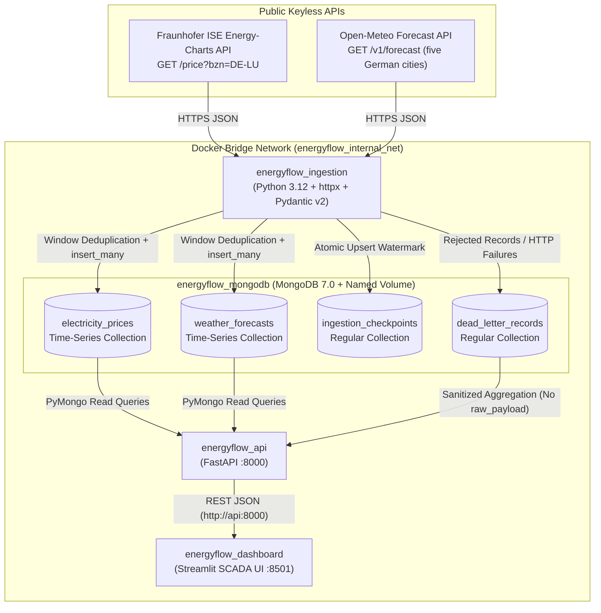

# EnergyFlowGermany — Real-Time Energy Data & Intelligence

**EnergyFlowGermany** is a containerized data engineering portfolio platform built with **Python 3.12**, **httpx**, **Pydantic v2**, **MongoDB 7**, **FastAPI**, **Streamlit**, and **Docker Compose**.

It collects public German day-ahead electricity spot prices (**Fraunhofer ISE Energy-Charts**) and hourly meteorological forecasts (**Open-Meteo**), enforces strict schema and array-alignment validation, persists records into **MongoDB 7 time-series collections** with stateful checkpointing and Dead-Letter Queue (DLQ) routing, exposes analytical and baseline forecasting endpoints via **FastAPI**, and visualizes telemetry in a dark SCADA-inspired **Streamlit** control room.

---

## Table of Contents

1. [Project Purpose](#1-project-purpose)
2. [Architecture & Data Flow](#2-architecture--data-flow)
3. [Data Sources, Attribution & Licensing](#3-data-sources-attribution--licensing)
4. [Data Validation & Timezone Normalization](#4-data-validation--timezone-normalization)
5. [MongoDB 7 Time-Series Design, Idempotency & Deduplication](#5-mongodb-7-time-series-design-idempotency--deduplication)
6. [Dead-Letter Queue (DLQ) Behavior](#6-dead-letter-queue-dlq-behavior)
7. [FastAPI Analytical Service & Endpoints](#7-fastapi-analytical-service--endpoints)
8. [Streamlit SCADA Dashboard](#8-streamlit-scada-dashboard)
9. [Deterministic 6-Hour Baseline Forecasting Method](#9-deterministic-6-hour-baseline-forecasting-method)
10. [Installation & Environment Configuration](#10-installation--environment-configuration)
11. [Testing Instructions](#11-testing-instructions)
12. [Troubleshooting Guide](#12-troubleshooting-guide)
13. [Known Limitations](#13-known-limitations)

---

## 1. Project Purpose

Modern European power markets—and Germany (`DE-LU`) in particular—exhibit strong sensitivity to wind and solar generation conditions. **EnergyFlowGermany** demonstrates end-to-end data engineering best practices for ingesting, validating, storing, analyzing, and serving public energy-market and meteorological time-series data without relying on synthetic metrics, hardcoded credentials, or black-box claims.

---

## 2. Architecture & Data Flow



### Container Topology

| Service | Container Name | Internal Host:Port | Host Binding | Health Check |
| :--- | :--- | :--- | :--- | :--- |
| `mongodb` | `energyflow_mongodb` | `mongodb:27017` | `127.0.0.1:27017` | `mongosh` `db.adminCommand('ping').ok` |
| `ingestion` | `energyflow_ingestion` | *(background worker)* | *(none)* | Application-level MongoDB readiness retries + poll loop |
| `api` | `energyflow_api` | `api:8000` | `0.0.0.0:8000` | `GET http://127.0.0.1:8000/health` |
| `dashboard` | `energyflow_dashboard` | `dashboard:8501` | `0.0.0.0:8501` | `GET http://127.0.0.1:8501/_stcore/health` |

> **Strict Separation of Concerns**: The `dashboard` container builds from `dashboard/Dockerfile`, which copies only `.streamlit/` and `dashboard/` and contains **no MongoDB driver imports**. All dashboard reads occur exclusively over HTTP via `http://api:8000`.

---

## 3. Data Sources, Attribution & Licensing

Neither public endpoint requires an API key for non-commercial use:

1. **Fraunhofer ISE Energy-Charts API**
   - **Endpoint**: `https://api.energy-charts.info/price?bzn=DE-LU`
   - **Dataset**: Day-Ahead Electricity Spot Market Prices (`EUR / MWh`) for the Germany-Luxembourg (`DE-LU`) bidding zone.
   - **Attribution & License**: Primary data originates from **Bundesnetzagentur | SMARD.de**, licensed under **Creative Commons Attribution 4.0 International (CC BY 4.0)**. The `license_info` string returned by the endpoint is preserved on every stored document.

2. **Open-Meteo Weather Forecast API**
   - **Endpoint**: `https://api.open-meteo.com/v1/forecast`
   - **Default Locations**: Düsseldorf (`DE-DUS`), Berlin (`DE-BER`), Hamburg (`DE-HAM`), Munich (`DE-MUC`), and Frankfurt (`DE-FRA`), each requested using its own coordinates in `Europe/Berlin`.
   - **Variables**: Hourly `temperature_2m` (`°C`), `wind_speed_10m` (`km/h`), and `shortwave_radiation` (`W/m²`), requested explicitly with `timezone=Europe/Berlin`.
   - **Attribution**: Weather forecast data provided by **Open-Meteo.com** (CC BY 4.0 for non-commercial use). All Open-Meteo records are explicitly marked with `is_forecast=True` and `metadata.data_type="forecast"`.

---

## 4. Data Validation & Timezone Normalization

All external payloads are validated with **Pydantic v2** (`ingestion/schemas/`):

- **Array Alignment Enforcement**:
  - `EnergyChartsPriceResponse` verifies that `unix_seconds` and `price` are non-empty and have identical lengths (`len(unix_seconds) == len(price)`).
  - `OpenMeteoHourlyData` verifies that `time`, `temperature_2m`, `wind_speed_10m`, and `shortwave_radiation` are non-empty and all share the exact same length.
- **Strict Numeric Validation & No Value Fabrication**:
  - Uses `StrictInt` and `StrictFloat` with explicit boolean rejection (`isinstance(val, bool)`) and finiteness checks (`math.isfinite`) so `None`, `NaN`, `Inf`, or boolean values are never coerced or interpolated.
  - Physical lower bounds (`wind_speed_10m >= 0.0`, `shortwave_radiation >= 0.0`) are enforced per record.
- **Timezone Normalization**:
  - Energy-Charts `unix_seconds` are converted to UTC-aware `datetime` objects (`datetime.fromtimestamp(ts, tz=timezone.utc)`) while preserving `source_unix_seconds`.
  - Open-Meteo wall-clock timestamps (`Europe/Berlin`) are normalized to UTC using the payload's `utc_offset_seconds` while preserving `source_timestamp`, `source_timezone`, `source_utc_offset_seconds`, `forecast_version`, and `ingested_at`.

---

## 5. MongoDB 7 Time-Series Design, Idempotency & Deduplication

### Collection Layout

| Collection | Type | Configuration & Indexes | Purpose |
| :--- | :--- | :--- | :--- |
| `electricity_prices` | **Time-Series** | `timeField: "timestamp"`, `metaField: "metadata"`, `granularity: "hours"`<br>Index: `(metadata.bidding_zone, timestamp)` | Validated `DE-LU` spot price series |
| `weather_forecasts` | **Time-Series** | `timeField: "timestamp"`, `metaField: "metadata"`, `granularity: "hours"`<br>Index: `(metadata.location_id, timestamp)` | Validated hourly weather forecasts |
| `ingestion_checkpoints` | **Regular** | Unique Index: `(source, scope)` | High-water marks & run status |
| `dead_letter_records` | **Regular** | Indexes: `(source, failed_at DESC)`, `(resolved, failed_at DESC)` | Rejected records & upstream errors |

### Idempotency Without Time-Series Upserts
MongoDB 7 time-series collections store documents in compressed internal buckets (`system.buckets.<collection>`) and **do not support ordinary document `update_one(..., upsert=True)` operations**. EnergyFlowGermany achieves idempotency through:
1. **In-Memory Batch Deduplication**: Deduplicating incoming records by `(bidding_zone, timestamp)` or `(location_id, timestamp)`.
2. **Database Window Filtering**: Querying existing UTC timestamps within `[min_timestamp, max_timestamp]` for the target `bidding_zone`/`location_id` and calling `insert_many(..., ordered=False)` only for net-new timestamps (or executing a scoped `delete_many` + `insert_many` when refreshing a weather forecast window).
3. **Forecast Versioning**: Each Open-Meteo batch tags records with a `forecast_version` (`YYYYMMDDTHHMMSSZ`) and `ingested_at`. Analytical read queries in `APIRepository` deduplicate by UTC `timestamp` while selecting the newest `ingested_at` version.
4. **Checkpoint Rate-Limit Guard**: `IngestionRunner` checks `ingestion_checkpoints` before making upstream HTTP calls and skips redundant requests if a successful run occurred within `ENERGY_POLL_INTERVAL_SECONDS` (default `900s`) for Energy-Charts or `WEATHER_POLL_INTERVAL_SECONDS` (default `3600s`) for Open-Meteo.

---

## 6. Dead-Letter Queue (DLQ) Behavior

- **Record-Level Isolation**: If an individual array slice contains a `null` price/weather value or fails validation, only that slice is written to `dead_letter_records` (`stage="record_validation"` with `record_index`); all valid slices in the batch are still persisted, and the checkpoint status is recorded as `"partial_failure"`.
- **Upstream Failure Capture**: If an HTTP request fails after exhausting bounded retries (timeouts, HTTP 429 rate limits, 5xx errors, malformed JSON, or top-level schema mismatch), the error is captured in `dead_letter_records` (`stage="http_fetch"` or `"payload_validation"`) while preserving the previous `last_successful_timestamp` watermark in `ingestion_checkpoints`.
- **Payload Redaction**: `GET /admin/dlq-stats` queries `dead_letter_records` with `{"raw_payload": 0, "_id": 0}` projection so raw upstream payloads are never exposed through the API.

---

## 7. FastAPI Analytical Service & Endpoints

| Method & Path | Query Parameters | Description |
| :--- | :--- | :--- |
| `GET /health` | *(none)* | Reports `api_status` (`"up"`) and `mongodb_status` (`"connected"` \| `"disconnected"`) separately. Returns HTTP `200` when healthy, `503` when degraded. |
| `GET /telemetry/latest` | `bidding_zone=DE-LU`, `location_id=DE-DUS` | Returns the latest stored electricity price and weather forecast as independent objects with `timestamps_aligned` and `timestamp_delta_seconds`. Never merges unrelated timestamps. |
| `GET /analytics/summary` | `bidding_zone=DE-LU`, `location_id=DE-DUS`, `start`, `end`, `limit=168` | Computes descriptive statistics (`min`, `max`, `mean`, `median`, `negative_price_hours`) and exact-timestamp Pearson correlations (`r` vs. wind, solar, temperature). Explicitly reports `insufficient_data` when `< 3` aligned timestamps exist. Returns HTTP `422` if `start > end`. |
| `GET /forecast/6h` | `bidding_zone=DE-LU`, `history_window=24` | Computes a deterministic 6-hour baseline electricity price forecast (`model_version="baseline-v1.0"`, `is_machine_learning_model=False`). |
| `GET /admin/dlq-stats` | *(none)* | Returns total/unresolved/resolved DLQ counts and sanitized error categories without exposing `raw_payload`. |

Interactive OpenAPI documentation is available at `http://localhost:8000/docs` when the stack is running.

---

## 8. Streamlit SCADA Dashboard

Accessible at `http://localhost:8501`, styled as a dark SCADA control room with three tabs:
- **TAB 1 — LIVE MONITOR**: Latest spot price (`EUR / MWh`), latest weather forecast (`°C`, `km/h`, `W/m²`, badged as `FORECAST VALUE`), UTC and local `Europe/Berlin` timestamps, freshness badges (`FRESH`, `SCHEDULED / FORECAST HORIZON`, `STALE`, `NO DATA`), timestamp alignment banner, and source attribution.
- **TAB 2 — ENERGY ANALYTICS**: Interactive Plotly price and weather forecast time-series charts, descriptive KPIs, explicit UTC time ranges, and exact-timestamp Pearson correlations. Generation mix and renewable-share charts are automatically suppressed with an explicit notice unless those datasets have been ingested.
- **TAB 3 — FORECAST & DATA QUALITY**: Plots observed spot prices (solid cyan line) alongside the 6-hour deterministic baseline forecast (dashed amber line), displays the horizon weight table and documented limitations, and shows DLQ counts and sanitized error categories.

The sidebar lets you choose one or more weather cities: Düsseldorf (`DE-DUS`), Berlin (`DE-BER`), Hamburg (`DE-HAM`), Munich (`DE-MUC`), and Frankfurt (`DE-FRA`). The analytics tab compares their hourly temperature, wind-speed, and shortwave-radiation forecasts. Electricity prices are shared across the DE-LU market zone; they are not city-specific.

---

## 9. Deterministic 6-Hour Baseline Forecasting Method

`GET /forecast/6h` implements the `deterministic_damped_drift_mean_reversion_baseline` (`baseline-v1.0`) method:
1. Retrieves the trailing historical electricity price window (minimum 3 records required; default 24 records).
2. Computes the latest observed price $P_{t_0}$, arithmetic trailing mean $\bar{P}$, and hourly drift $\Delta = \frac{P_{t_0} - P_{t_{\text{start}}}}{\text{elapsed\_hours}}$.
3. For each horizon step $h \in \{1, 2, 3, 4, 5, 6\}$ hours ahead:
   - Persistence weight: $w_h = 0.5^h$, Mean-reversion weight: $1 - w_h$
   - Damped trend projection: $T_h = P_{t_0} + \Delta \sum_{i=1}^{h} 0.5^i$
   - Point forecast: $\hat{P}_{t_0 + h} = \text{round}(w_h \cdot T_h + (1 - w_h) \cdot \bar{P},\ 2)$
4. **Guarantees**: Contains zero random noise (`is_machine_learning_model: false`) and returns identical outputs for identical stored inputs.

---

## 10. Installation & Environment Configuration

### Prerequisites
- Ubuntu 24.04 LTS (or compatible Linux/macOS environment)
- Docker & Docker Compose v2
- Python 3.12+ (optional, for running offline unit tests on the host)

### Environment Variables (`.env.example`)
```env
# MongoDB
MONGO_URI=mongodb://mongodb:27017/
DB_NAME=energy_flow_germany

# Energy-Charts
ENERGY_CHARTS_BASE_URL=https://api.energy-charts.info
ENERGY_CHARTS_BIDDING_ZONE=DE-LU

# Open-Meteo
OPEN_METEO_BASE_URL=https://api.open-meteo.com/v1/forecast
WEATHER_LATITUDE=51.2277
WEATHER_LONGITUDE=6.7735
WEATHER_TIMEZONE=Europe/Berlin
# WEATHER_LOCATIONS is a JSON array of location_id, location_name, latitude,
# longitude, and timezone objects. See .env.example for the five-city default.

# FastAPI
API_HOST=0.0.0.0
API_PORT=8000
API_BASE_URL=http://api:8000

# Streamlit
DASHBOARD_PORT=8501

# Ingestion
ENERGY_POLL_INTERVAL_SECONDS=900
WEATHER_POLL_INTERVAL_SECONDS=3600
HTTP_TIMEOUT_SECONDS=20
```

### Step-by-Step Setup
1. **Create `.env` from the template**:
   ```bash
   cp .env.example .env
   ```
2. **Build and start all services**:
   ```bash
   docker compose up --build -d
   docker compose ps
   ```
3. **Access the services**:
   - FastAPI Health: `http://localhost:8000/health`
   - FastAPI OpenAPI Docs: `http://localhost:8000/docs`
   - Streamlit SCADA Dashboard: `http://localhost:8501`

---

## 11. Testing Instructions

The unit test suite (`tests/unit/`) uses local JSON fixtures (`tests/fixtures/`) and in-memory MongoDB/HTTP test doubles—**no live API calls or running containers are required**:

```bash
.venv/bin/pytest -v
```

To trigger a live one-shot ingestion inside the running Docker Compose stack:
```bash
docker compose exec ingestion python -m ingestion.runner --once --force
```

---

## 12. Troubleshooting Guide

| Symptom | Cause | Resolution |
| :--- | :--- | :--- |
| `GET /health` returns HTTP `503` (`"mongodb_status": "disconnected"`) | MongoDB container is still starting or the `energyflow_mongodb_data` volume was initialized with a different auth state. | Check `docker logs energyflow_mongodb`. If switching MongoDB authentication settings, recreate the volume with `docker compose down -v && docker compose up --build -d`. |
| `GET /analytics/summary` returns `"status": "insufficient_data"` | Fewer than 3 exact matching UTC timestamps exist between `electricity_prices` and `weather_forecasts`. | Check `docker logs energyflow_ingestion` or trigger `docker compose exec ingestion python -m ingestion.runner --once --force`. |
| Ingestion logs `Skipping ... API request: last ingestion was Xs ago` | Checkpoint rate-limit guard (`ENERGY_POLL_INTERVAL_SECONDS=900` / `WEATHER_POLL_INTERVAL_SECONDS=3600`) prevented redundant polling. | Pass `--force` (`python -m ingestion.runner --once --force`) or adjust the poll interval variables in `.env`. |

---

## 13. Known Limitations

1. **Reference City Coordinates**: Weather forecasts use one representative coordinate per selected city, not a capacity-weighted spatial grid across German wind and solar zones.
2. **Baseline Statistical Forecast Only**: `GET /forecast/6h` is a deterministic damped-drift + mean-reversion heuristic baseline (`baseline-v1.0`), not a trained machine-learning model, and cannot predict sudden regime shifts or merit-order price spikes.
3. **No Generation Mix Ingestion Yet**: Only day-ahead spot prices (`/price`) and weather forecasts (`/v1/forecast`) are currently ingested; generation mix and renewable-share charts are intentionally suppressed in the dashboard until those endpoints are added.
4. **No Authentication / TLS Termination**: FastAPI and Streamlit do not implement authentication, RBAC, or TLS termination and are intended for local/portfolio demonstration rather than unguarded public internet exposure.
